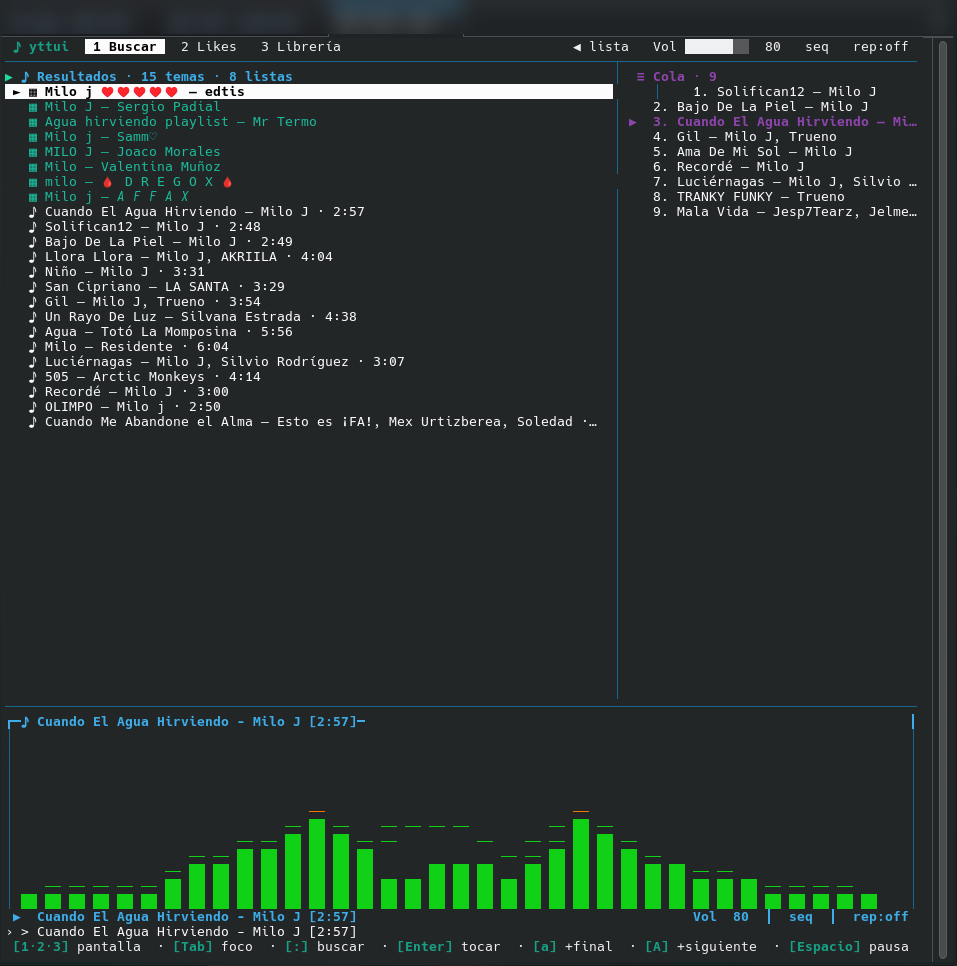

# yttui - YouTube Music en tu terminal (CachyOS)

Reproductor simple, sin ads, con atajos. Escribes `yttui` y listo.



## Instalar

Requisitos: `python3`, `mpv` y conexión a internet (`yt-dlp` y `ytmusicapi` se instalan solos con el paquete).

```bash
git clone https://github.com/LanderXavier/yttui.git
cd yttui
pip install -e . --break-system-packages
```

El comando queda en `~/.cargo/bin/yttui` (está en tu PATH). Si reinstalas y no lo encuentra:

```bash
ln -sf ~/.local/bin/yttui ~/.cargo/bin/yttui
```

> En CachyOS/Arch sin `pip` de sistema, instala en venv y enlaza los dos binarios al PATH. Si no, sale `No such file or directory: 'yt-dlp'` y no suena nada:
>
> ```bash
> python3 -m venv ~/.local/share/yttui-venv
> ~/.local/share/yttui-venv/bin/pip install -e .
> mkdir -p ~/.local/bin ~/.cargo/bin
> ln -sf ~/.local/share/yttui-venv/bin/yttui ~/.local/bin/yttui
> ln -sf ~/.local/share/yttui-venv/bin/yttui ~/.cargo/bin/yttui
> ln -sf ~/.local/share/yttui-venv/bin/yt-dlp ~/.local/bin/yt-dlp
> ln -sf ~/.local/share/yttui-venv/bin/yt-dlp ~/.cargo/bin/yt-dlp
> ```

Verifica que todo quedó bien antes de seguir:

```bash
yttui --help
yt-dlp --version
mpv --version
```

Si los tres responden, la instalación está lista. Falta solo la configuración de abajo (una sola vez).

## Configurar (1 vez)

```bash
yttui --setup
```

### 1. Cookies (para reproducir sin bloqueos)

Sin cookies YouTube bloquea los streams y no suena nada. Paso a paso:

1. En tu navegador instala la extensión **"Get cookies.txt LOCALLY"** (está para Chrome y Firefox).
2. Entra a `music.youtube.com` con tu cuenta e inicia sesión.
3. Con esa pestaña abierta, abre la extensión y exporta las cookies del sitio (te descarga un `cookies.txt`).
4. Mueve ese archivo a `~/.config/yttui/cookies.txt`:
   ```bash
   mkdir -p ~/.config/yttui
   mv ~/Descargas/cookies.txt ~/.config/yttui/cookies.txt
   ```

> Si cambias tu contraseña o cierras sesión en el navegador, las cookies caducan: repite la exportación y reemplaza el archivo.

### 2. Login (para Mis Likes y Mi Librería)

1. En `music.youtube.com` ya con tu sesión, pulsa F12 para abrir las herramientas de desarrollador y ve a la pestaña **Red** (Network).
2. Filtra por `/browse` y navega un poco por la página para que aparezcan peticiones.
3. Clic derecho en una petición `/browse` > copiar los **"Request headers"** (como texto).
4. Pégalo cuando `yttui --setup` te lo pida: eso genera `~/.config/yttui/browser.json` y listo.

Sin login igual puedes buscar y reproducir. Con login ves Likes/Librería.

## Usar

```bash
yttui
```

Pantallas: `1` Buscar (temas + playlists), `2` Likes, `3` Mi Librería. La cola va siempre a la derecha.

Atajos:

| Tecla | Acción |
|---|---|
| `Tab` / `Shift+Tab` | cambiar el seleccionado entre buscar y cola |
| `/` | buscar temas o playlists |
| `Enter` | reproducir lo seleccionado (en cola: reproduce ese tema) |
| `a` | añadir a continuación del que suena |
| `A` | añadir al final de la cola |
| `Ctrl+A` | añadir todos los temas visibles al final |
| `Espacio` | pausa |
| `n` / `p` | siguiente / anterior |
| `s` | shuffle on/off |
| `r` | repeat off -> all -> one |
| `+` / `-` | volumen |
| `<` / `->` | +/-10s |
| `j`/`k` o flechas | moverse en el panel con el foco (`>`) |
| `Supr` | quitar de la cola (el del cursor `>` si el foco está en cola) |
| `?` | ayuda |
| `q` | salir |

Visualizador: panel grande de 12 filas estilo WMP/Ares con el título arriba y barras `██` de colores (verde -> amarillo -> rojo) que laten con la música, más picos `──` que caen lento. Las barras centrales son altas y se apagan hacia los lados. Lee el audio real del sistema (monitor PipeWire + FFT con numpy): los graves pegan con los golpes del tema. Si no hay monitor, usa simulación. Terminal mínima 70x29 para el modo completo; en ventanas chicas (dropdown arriba-derecha, panel lateral) entra solo el modo compacto: tema actual + onda de trazo fino `▁▂▃▄▅▆▇█` en 2-3 filas + lista con foco + pie con los atajos clave, con los mismos atajos.

Modo radio [radio]: al poner un tema suelto se precargan parecidos en la cola automáticamente (hilo en segundo plano, sin congelar). Cuando se acaba un tema o la cola, sigue solo con parecidos (como el autoplay de YouTube). Con `n` al final de la cola también arranca radio. `r` en `one` repite el mismo.

Sin anuncios: usa stream directo vía `yt-dlp + mpv`. La URL se guarda en caché de sesión y el siguiente tema se precarga en segundo plano: el primer cambio tarda 1-3s (red), los siguientes son casi instantáneos. La carga no congela la app: la bolita `⠋` sigue girando mientras resuelve. Al cambiar hay fundido chiquito (baja 0.3s, sube 0.45s).

Widget de Plasma (`plasmusic-toolbar` / Reproductor multimedia): al abrir `yttui` se lanza solo un demonio MPRIS aparte (`python -m yttui.mpris_daemon`, proceso separado y silenciado) que expone `org.mpris.MediaPlayer2.yttui`. Los botones Next/Prev/Play le escriben órdenes a la app por `/tmp/yttui-cmd.fifo`, así la TUI nunca se ensucia. Si el widget no lo ve, ponlo en reproductor automático o `yttui` (no `mpv`).

## Cómo funciona

- `src/yttui/ytm.py`: search + likes + librería + `yt-dlp -g -f bestaudio` para URL.
- `src/yttui/player.py`: mpv `--idle --input-ipc-server=/tmp/yttui-mpv.sock`.
- `src/yttui/app.py`: TUI con curses.
- `src/yttui/setup_wizard.py`: genera config.
- OAuth descartado: ahora pide Client ID de Google Cloud, más lío que cookies.

## Si algo falla

- `yttui: command not found` -> rehaz el symlink de arriba o abre nueva terminal.
- `No such file or directory: 'yt-dlp'` -> `yt-dlp` quedó solo en el venv, enlázalo al PATH (ver bloque venv de arriba) y reinicia con `q` + `yttui`.
- Likes vacíos / "Falta login" -> `yttui --setup` de nuevo.
- No reproduce un tema restringido -> pon `cookies.txt` fresco (caducan si cierras sesión).
- mpv sin sonido -> prueba `mpv --no-video <url>` y revisa volumen PipeWire.
- Reinstalar limpio: `pip install -e . --break-system-packages --force-reinstall`.
